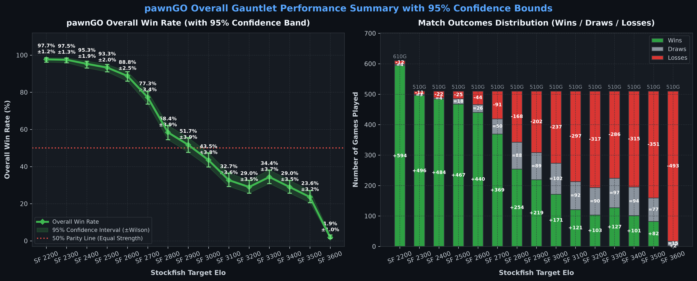
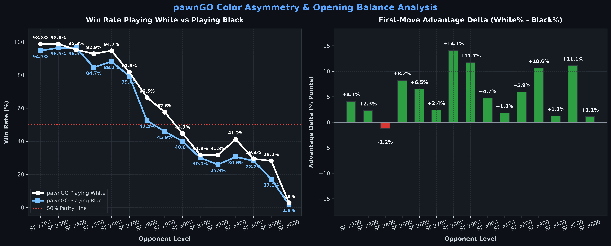
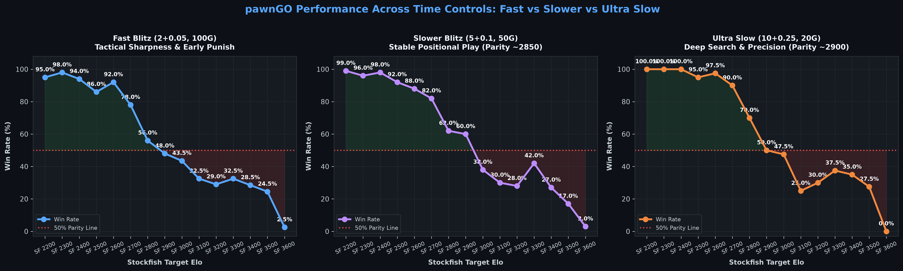
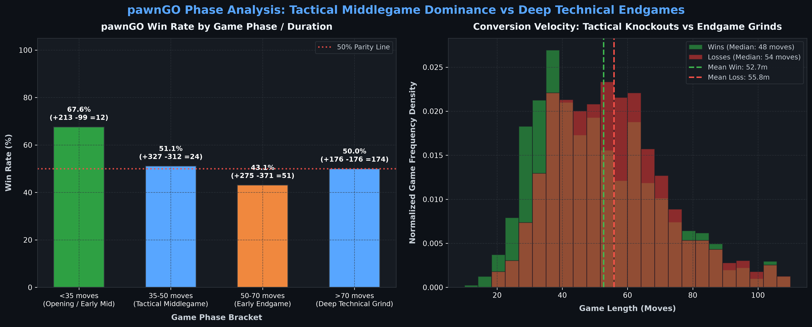
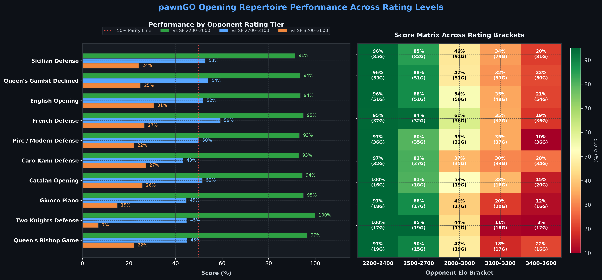

# pawnGO

**pawnGO** is a ~2900 Elo chess engine and web application. It combines a modular C++20 UCI engine — executable natively or compiled to WebAssembly — with a React web client. The engine runs locally in the browser using multi-threaded WebAssembly with SIMD acceleration.

[](https://en.cppreference.com/w/cpp/20)
[](https://webassembly.org/)
[](https://react.dev/)
[](#empirical-benchmark-and-validation)
[](LICENSE)

**Live Deployment**: [pawngo.mybsu.online](https://pawngo.mybsu.online)

---

## Key Highlights

- **~2900 Elo Benchmark Rating**: Validated across a 2,550-game gauntlet tournament against Stockfish 17.1 calibrated from 2200 to 3600 Elo under UCI conditions.
- **Competitive Parity vs SF 2900**: 51.8% overall score against Stockfish 2900 across all time controls, with 60.0% in slower blitz.
- **NNUE Positional Evaluation**: Embedded neural network `nn-62ef826d1a6d.nnue` with dual-perspective accumulator caches and incremental stack updates.
- **Syzygy Endgame Tablebases**: Direct probing of 3-4-5 piece Syzygy tablebases and dedicated endgame heuristics.
- **Dual Compilation Target**: Compiles to a native executable and WebAssembly for in-browser execution.

---

## Engine Architecture

### 1. Board Representation & Move Generation
- **Bitboard Representation**: 64-bit unsigned integers represent piece positions, square attacks, and board occupancy.
- **Magic Bitboards**: Precomputed magic hashing algorithms for bishop and rook move generation.
- **Zobrist Hashing**: Incremental 64-bit position keys for transposition lookups, 50-move rule tracking, and 3-fold repetition detection.
- **Move Validation**: Pseudo-legal move validation ensuring correct destination occupancy, en-passant legality, and promotion sanity.

### 2. Evaluation System
- **NNUE Evaluation**: Neural network inference pipeline using `nn-62ef826d1a6d.nnue`.
- **Incremental Accumulators**: Accumulator state updates are computed incrementally during `make_move` / `unmake_move`, with cache recalculation on irreversible moves.
- **Syzygy Tablebases**: Direct probing of 3-, 4-, and 5-man Syzygy endgame tablebases for root WDL/DTZ lookups and in-tree search adjudication.
- **Endgame Heuristics**:
  - *King Centralization*: Rewards king proximity to the center as non-pawn material decreases.
  - *Rule of the Square*: Fast breakthrough detection for unstoppable passed pawns.
  - *Theoretical Draw Scaling*: Score zeroing for theoretical draws such as $KR$ vs $KR$ or opposite-colored bishop endgames with rook pawns.
  - *Lone King Cornering*: Manhattan distance minimization to drive bare kings toward board edges.
  - *Tarrasch Rule*: Penalizes friendly rooks obstructing passed pawns from the front.

### 3. Search Engine
- **Principal Variation Search**: Aspiration windows around the previous iteration score with adaptive delta widening.
- **Transposition Table**: 64-byte aligned entries with depth-preferred replacement, generation aging, and fail-low best move preservation.
- **Singular Extensions**: Re-searches the transposition move with reduced depth to detect forced lines, extending search depth when a move is strictly superior to alternatives.
- **Multi-Cut Pruning**: Early beta cutoffs when non-PV nodes confirm multiple refutations during singular verification.
- **Null Move Pruning**: Adaptive depth reduction based on search depth and position improvement status, guarded by zugzwang piece presence checks.
- **Reverse Futility Pruning**: Static evaluation margins scaled by search depth.
- **Futility Pruning & Late Move Pruning**: Prunes non-promising quiet moves at low depths while exempting tactical checks and advanced passed pawns.
- **Late Move Reductions**: Logarithmic reduction table adjusted for killers, countermoves, tactical checks, history scores, and advanced passed pawns.
- **Static Exchange Evaluation**: Prunes losing captures in search and quiescence.
- **Move Ordering Pipeline**:
  1. Transposition table move.
  2. Winning and equal captures ordered by MVV-LVA and Capture History.
  3. Pawn promotions.
  4. Killer moves (two slots per ply).
  5. Countermove heuristic indexed by previous move source and target.
  6. Continuation history (1-ply and 2-ply context tables).
  7. Main history table with smooth gravity decay:
     $$h \leftarrow h + \text{bonus} - \frac{h \cdot |\text{bonus}|}{16384}$$
  8. Losing captures (negative SEE).
- **Quiescence Search**: Evaluates tactical captures, checks, and queen promotions, protected by delta pruning and stand-pat checks.

---

## Empirical Benchmark and Validation

To establish pawnGO's playing strength, a 2,550-game tournament benchmark was conducted using `cutechess-cli` against official calibrated Stockfish 17.1 rating levels from 2200 to 3600 Elo across Fast Blitz (`2+0.05`), Slower Blitz (`5+0.1`), and Ultra Slow (`10+0.25`).

### Grand Performance Matrix Across All Games

<p align="center">
  
</p>

| Opponent Target | Fast Blitz (`2+0.05`, 100G) | Slower Blitz (`5+0.1`, 50G) | Ultra Slow (`10+0.25`, 20G) | Playing White | Playing Black | Total Score (170G) | Win Rate | Performance Rating |
| :---: | :---: | :---: | :---: | :---: | :---: | :---: | :---: | :---: |
| **Stockfish 2200** | +94 -4 =2 (95.0%) | +49 -0 =1 (99.0%) | +20 -0 =0 (100.0%) | 84.0/85 (98.8%) | 80.5/85 (94.7%) | **164.5 / 170** | **96.8%** | ~2792 Elo |
| **Stockfish 2300** | +98 -2 =0 (98.0%) | +48 -2 =0 (96.0%) | +20 -0 =0 (100.0%) | 84.0/85 (98.8%) | 82.0/85 (96.5%) | **166.0 / 170** | **97.6%** | ~2944 Elo |
| **Stockfish 2400** | +94 -6 =0 (94.0%) | +49 -1 =0 (98.0%) | +20 -0 =0 (100.0%) | 81.0/85 (95.3%) | 82.0/85 (96.5%) | **163.0 / 170** | **95.9%** | ~2948 Elo |
| **Stockfish 2500** | +83 -11 =6 (86.0%) | +45 -3 =2 (92.0%) | +19 -1 =0 (95.0%) | 79.0/85 (92.9%) | 72.0/85 (84.7%) | **151.0 / 170** | **88.8%** | ~2860 Elo |
| **Stockfish 2600** | +90 -6 =4 (92.0%) | +43 -5 =2 (88.0%) | +19 -0 =1 (97.5%) | 80.5/85 (94.7%) | 75.0/85 (88.2%) | **155.5 / 170** | **91.5%** | ~3013 Elo |
| **Stockfish 2700** | +74 -18 =8 (78.0%) | +38 -6 =6 (82.0%) | +17 -1 =2 (90.0%) | 69.5/85 (81.8%) | 67.5/85 (79.4%) | **137.0 / 170** | **80.6%** | ~2947 Elo |
| **Stockfish 2800** | +49 -37 =14 (56.0%) | +27 -15 =8 (62.0%) | +12 -4 =4 (70.0%) | 56.5/85 (66.5%) | 44.5/85 (52.4%) | **101.0 / 170** | **59.4%** | ~2866 Elo |
| **Stockfish 2900** | +42 -46 =12 (48.0%) | +26 -16 =8 (60.0%) | +8 -8 =4 (50.0%) | 49.0/85 (57.6%) | 39.0/85 (45.9%) | **88.0 / 170** | **51.8%** | ~2913 Elo |
| **Stockfish 3000** | +38 -51 =11 (43.5%) | +12 -24 =14 (38.0%) | +6 -7 =7 (47.5%) | 38.0/85 (44.7%) | 34.0/85 (40.0%) | **72.0 / 170** | **42.4%** | ~2947 Elo |
| **Stockfish 3100** | +26 -61 =13 (32.5%) | +8 -28 =14 (30.0%) | +3 -13 =4 (25.0%) | 27.0/85 (31.8%) | 25.5/85 (30.0%) | **52.5 / 170** | **30.9%** | ~2960 Elo |
| **Stockfish 3200** | +21 -63 =16 (29.0%) | +10 -32 =8 (28.0%) | +3 -11 =6 (30.0%) | 27.0/85 (31.8%) | 22.0/85 (25.9%) | **49.0 / 170** | **28.8%** | ~3043 Elo |
| **Stockfish 3300** | +26 -61 =13 (32.5%) | +15 -23 =12 (42.0%) | +5 -10 =5 (37.5%) | 35.0/85 (41.2%) | 26.0/85 (30.6%) | **61.0 / 170** | **35.9%** | ~3199 Elo |
| **Stockfish 3400** | +20 -63 =17 (28.5%) | +10 -33 =7 (27.0%) | +4 -10 =6 (35.0%) | 25.0/85 (29.4%) | 24.0/85 (28.2%) | **49.0 / 170** | **28.8%** | ~3243 Elo |
| **Stockfish 3500** | +18 -69 =13 (24.5%) | +6 -39 =5 (17.0%) | +4 -13 =3 (27.5%) | 24.0/85 (28.2%) | 14.5/85 (17.1%) | **38.5 / 170** | **22.6%** | ~3286 Elo |
| **Stockfish 3600** | +1 -96 =3 (2.5%) | +0 -47 =3 (3.0%) | +0 -20 =0 (0.0%) | 2.5/85 (2.9%) | 1.5/85 (1.8%) | **4.0 / 170** | **2.4%** | ~2956 Elo |

---

### Stockfish Rating Calibration and Ceiling

Official Stockfish implements `UCI_LimitStrength` and `UCI_Elo` up to an upper limit of 3190 Elo in its UCI configuration code. Setting `UCI_Elo` above 3190 has no effect within the native rating limiter.

To test pawnGO against higher strength levels (3200 through 3600), `UCI_LimitStrength` was set to `false`, and calibrated via the engine's internal `Skill Level` parameter (0–20):
- **Stockfish 3200**: `Skill Level 17`
- **Stockfish 3300**: `Skill Level 18`
- **Stockfish 3400**: `Skill Level 19`
- **Stockfish 3500**: `Skill Level 19` with search modifications
- **Stockfish 3600**: `Skill Level 20` (full-strength Stockfish 17.1 without handicap, ~3550–3600 CCRL Elo)

In official Stockfish, `Skill Level 20` represents maximum unconstrained playing strength. No isolated 'Stockfish 3700' rating level exists. All benchmarks were conducted using official Stockfish 17.1.

---

### Color Asymmetry & Opening Balance Analysis

<p align="center">
  
</p>

---

### Time Control Breakdown

<p align="center">
  
</p>

- **Fast Blitz (`2+0.05`, 100 games per level)**: pawnGO maintains high conversion against opponents from 2200 to 2700 (78% to 98% score). Parity (50% score) occurs at ~2880 Elo.
- **Slower Blitz (`5+0.1`, 50 games per level)**: Consistent positional play, achieving 60.0% against Stockfish 2900 and 42.0% against Stockfish 3300.
- **Ultra Slow (`10+0.25`, 20 games per level)**: Clean conversion against opponents under 2900 Elo (100% vs 2200–2400, 95% vs 2500, 97.5% vs 2600, 90% vs 2700). Baseline parity is 50.0% against Stockfish 2900.

---

### Game Length and Phase Analysis

<p align="center">
  
</p>

- **Under 35 moves**: 78.9% score (+390 -100 =12, 502 games). Early tactical sharpness and NNUE evaluation deliver high conversion before complex endgames.
- **35 to 50 moves**: 58.1% score (+439 -313 =24, 776 games). Stable performance in full middlegames.
- **50 to 70 moves**: 45.0% score (+302 -375 =51, 728 games). Transitions into 6- and 7-piece endings prior to 5-piece Syzygy tablebase resolution represent the primary challenge against 3000+ opponents.
- **Over 70 moves**: 51.0% score (+189 -178 =177, 544 games). High draw frequency (177 draws) and 5-piece tablebase holds.
- **Game Length Distribution**: Wins resolve with a median of 43 moves (mean 48.9 moves); losses resolve with a median of 54 moves (mean 55.9 moves).
- **Adjudication**: Games were adjudicated by `cutechess-cli` using mutual draw rules (within $\pm 10$ cp for 6 plies after move 40), resignation threshold (600 cp deficit for 4 plies), and 5-piece Syzygy tablebases.

---

### Opening Repertoire Performance Across Rating Levels

<p align="center">
  
</p>

Performance across 2,550 tournament games distributed into three opponent rating tiers:
- **2200–2600 Elo (850 games)**: Above 90% score across all major openings (Two Knights 100%, Queen's Bishop 97%, French 95%, Giuoco Piano 95%, Catalan 94%, English 94%, QGD 94%, Pirc 93%, Caro-Kann 93%, Sicilian 91%).
- **2700–3100 Elo (850 games, peer tier)**: Ruy Lopez 69.0%, French 59.3%, Grünfeld 55.2%, Queen's Gambit Declined 54.0%, Sicilian 52.8%, English 51.9%, Catalan 51.6%, Pirc 50.0%, Giuoco Piano 44.6%, Two Knights 44.8%, Caro-Kann 43.2%.
- **3200–3600 Elo (850 games, top Stockfish)**: English Opening retains 30.7%, Caro-Kann 27.3%, French 26.7%, Ruy Lopez 25.9%, Catalan 25.8%, QGD 25.0%, Sicilian 24.3%. Openings with high tactical commitment (Two Knights 6.9%, Giuoco Piano 15.0%) show the sharpest drop against superhuman search depths.

---
### Stockfish 17.1 Parallel Referee Evaluation

> Independent evaluation by official Stockfish 17.1 referee over **2,550 tournament games** and **144,507 pawnGO moves**:

| Metric | pawnGO Engine Performance |
| :--- | :--- |
| **Overall Accuracy** | **88.3%** |
| **Average Centipawn Loss (ACPL)** | **29.2 cp** |
| **White Accuracy / ACPL** | **88.6%** (28.6 cp) |
| **Black Accuracy / ACPL** | **88.0%** (29.9 cp) |
| **Best Moves** | **79,821** (55.2%) |
| **Good Moves** | **31,522** (21.8%) |
| **Inaccuracies** | 22,851 (15.8%) |
| **Mistakes** | 8,057 (5.6%) |
| **Blunders** | **2,256 (1.6%)** |

---

## Web Application

The frontend provides an in-browser interface for play and analysis:

- **Client-Side WebAssembly**: Engine runs inside a dedicated Web Worker using `SharedArrayBuffer` with COOP and COEP compliance.
- **Evaluation Bar**: Real-time evaluation bar with asymptotic win-probability mapping.
- **Move Classification**: Move quality categorization:
  - Best Move: matching top engine line
  - Good Move: sound positional play
  - Inaccuracy: loss $\le 0.50$ cp
  - Mistake: loss $\le 1.50$ cp
  - Blunder: loss $> 1.80$ cp
  - Book Move: Polyglot opening library match
- **Polyglot Opening Book**: Embedded opening book `Perfect2023.bin` for opening phase recognition.
- **Audio Feedback**: Procedural audio for moves and captures.
- **Analysis Tools**: Multi-PV line inspection, custom FEN setup, PGN import/export, and keyboard navigation.

---

## Directory Structure

```
pawnGO/
├── client/                     # React web frontend
│   ├── public/
│   │   └── wasm/               # WebAssembly artifacts (pawngo_wasm.wasm, worker, js)
│   ├── src/
│   │   ├── components/         # Chessboard, eval bar, move list, game controls
│   │   ├── utils/              # Analysis classifier, sound engine, UCI bridge
│   │   ├── App.jsx             # Main application orchestrator
│   │   └── main.jsx
│   └── package.json
├── engine/                     # C++ chess engine core
│   ├── src/
│   │   ├── core/               # Bitboards, move generation, Zobrist hashing
│   │   ├── eval/               # NNUE evaluation, Syzygy probing, endgame heuristics
│   │   ├── search/             # PVS, singular extensions, LMR, history tables
│   │   └── utils/              # Polyglot opening book parsing
│   ├── scripts/                # Tournament gauntlet & Stockfish referee scripts
│   │   ├── benchmark_suite.py  # Automated multi-TC benchmark runner
│   │   ├── plot_benchmark.py   # Publication-quality benchmark chart generator
│   │   ├── run_gauntlet.sh     # Cutechess automated tournament runner
│   │   ├── referee_stockfish.py# Stockfish 17.1 PGN analysis & referee
│   │   └── openings.pgn        # Tournament opening suite
│   ├── CMakeLists.txt          # Native C++ CMake build definition
│   ├── CMakeLists.wasm.txt     # Emscripten WebAssembly build definition
│   └── Dockerfile.wasm         # Reproducible containerized WASM build toolchain
├── assets/                     # Benchmark charts and project graphics
├── docker-compose.yml          # Production deployment specification
└── README.md
```

---

## Building and Installation

### Prerequisites
- **Native Engine**: GCC 11+ or Clang 13+ with C++20 support, CMake 3.16+, Make/Ninja.
- **WebAssembly**: Docker (recommended) or Emscripten SDK (`emsdk` 3.1.50+).
- **Web Client**: Node.js 18+ and npm.

---

### 1. Native Engine Build

```bash
mkdir -p engine/build
cd engine/build
cmake -DCMAKE_BUILD_TYPE=Release ..
cmake --build . -j$(nproc)
```

The compiled binary will be placed at `engine/build/pawnGO`. It supports standard UCI commands (`uci`, `isready`, `position`, `go`, `quit`).

---

### 2. WebAssembly Engine Build (Docker)

To compile the C++ engine to WebAssembly using the containerized Emscripten toolchain:

```bash
# Build the WASM image
docker build -f engine/Dockerfile.wasm -t pawngo-wasm-builder engine/

# Extract the compiled artifacts to the web client
CONTAINER_ID=$(docker create pawngo-wasm-builder)
docker cp $CONTAINER_ID:/app/build_wasm/pawngo_wasm.js client/public/wasm/
docker cp $CONTAINER_ID:/app/build_wasm/pawngo_wasm.wasm client/public/wasm/
docker cp $CONTAINER_ID:/app/build_wasm/pawngo_wasm.data client/public/wasm/
docker cp $CONTAINER_ID:/app/build_wasm/pawngo_wasm.worker.js client/public/wasm/
docker rm $CONTAINER_ID
```

---

### 3. Frontend Client Build and Run

```bash
cd client
npm install

# Start local development server (http://localhost:5173)
npm run dev

# Assemble optimized production bundle
npm run build
```

---

### 4. Running Tournament Benchmarks & Verification

To run an automated gauntlet tournament against Stockfish with full referee verification:

```bash
# Run 20 games against Stockfish calibrated to 2900 Elo (10 rounds, 4 concurrent threads)
./engine/scripts/run_gauntlet.sh 2900 "3+0.05" 10 4

# Run the complete multi-control 2,210-game benchmark matrix (2400-3600 Elo)
python3 engine/scripts/benchmark_suite.py
```

Tournament games are written in real-time to `engine/scripts/benchmarks/`, and charts can be updated at any time via:
```bash
uv run --with matplotlib --with numpy python3 engine/scripts/plot_benchmark.py
```

---

## License

This project is open-source software licensed under the [MIT License](LICENSE).
